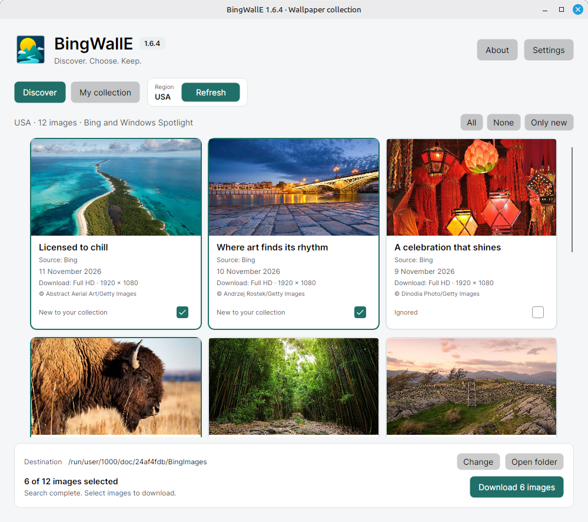
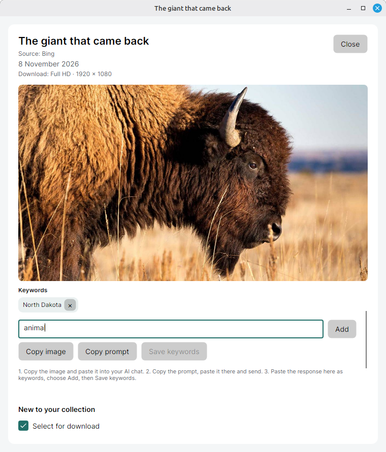
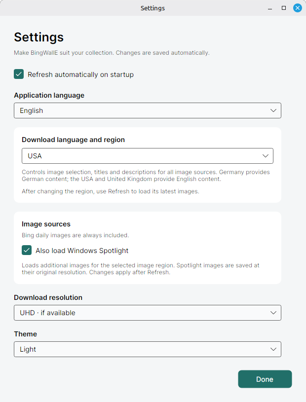

<p align="center">
  
</p>

# BingWallE

Browse Bing's daily wallpapers and optional Windows Spotlight images, then save your
favorites to a local collection. BingWallE is available for Windows, macOS, and Linux.

[Download for Windows, macOS, or Linux](https://github.com/gruetze-software/BingWallE/releases/latest)

<a href="https://flathub.org/apps/de.gruetze_software.BingWallE"></a>
<a href="https://snapcraft.io/bingwalle"></a>





## Features

- **Discover** brings together Bing wallpapers from twelve regions and, if enabled,
  Windows Spotlight images. Download selected Bing images in HD, Full HD, or UHD
  where available. Spotlight images are saved at the resolution provided by the source.
- **My collection** browses JPEG, PNG, and WebP files in your selected folder offline.
  Search by title, description, filename, or keyword and filter by source, minimum
  resolution, or date saved.
- **Image previews** open in a resizable window and show the source, resolution,
  description, copyright, and keywords when available.
- **Editable keywords** start with suggestions from the title and description.
  Add your own tags, separate multiple tags with semicolons, or remove individual tags.
  Save changes to a local JPEG or include them when you download an image.
- **Optional AI chat assistance** lets you copy a preview and a suggested prompt
  separately, paste them into a chat of your choice, and review and add the returned
  tags. BingWallE copies them to the clipboard. You decide what to share.
- **Embedded metadata** includes titles, descriptions, copyright, sources, and keywords
  in downloaded JPEGs when available. BingWallE uses EXIF and XMP and preserves the
  compressed JPEG image data.
- **Preferences** include a German or English interface independent of the image
  region, light and dark themes, and remembered window sizes and maximized states.

## Installation

- **Windows (x64)** — Extract the ZIP and run `bingwalle.exe`.
- **macOS (14 or later)** — Open the DMG for Apple Silicon (`arm64`) or Intel (`x64`)
  and drag BingWallE to Applications.
- **Linux** — Install from Flathub or the Snap Store using the badges above. The
  [GitHub downloads](https://github.com/gruetze-software/BingWallE/releases/latest)
  also include an x64 DEB for Debian, Ubuntu, and Ubuntu-based Linux Mint, plus an
  x64 TAR.GZ archive. BingWallE supports native Wayland with X11 fallback.

```bash
flatpak install flathub de.gruetze_software.BingWallE
sudo snap install bingwalle
```

Use the command for your preferred package format. See the
[Flatpak setup guide](https://flathub.org/setup) or the
[snapd installation guide](https://snapcraft.io/docs/tutorials/install-the-daemon/)
if you need to enable either format on your distribution.

## Build from source

With the .NET 10 SDK installed, run these commands from the repository root.

```sh
dotnet run --project BingWallE
dotnet test BingWallE.sln -c Release
```

See the [release packaging guide](docs/RELEASE-PACKAGING.md),
[Flatpak build guide](docs/FLATPAK-BUILD.md), and
[Snap publishing guide](docs/SNAP-PUBLISHING.md) for packaging instructions.

## Support BingWallE

<a href="https://ko-fi.com/gruetzesoftware"></a>

## License

BingWallE is an independent project by Grütze-Software. The code is available under
the [MIT License](LICENSE). Image rights remain with the credited photographers and
rights holders.
